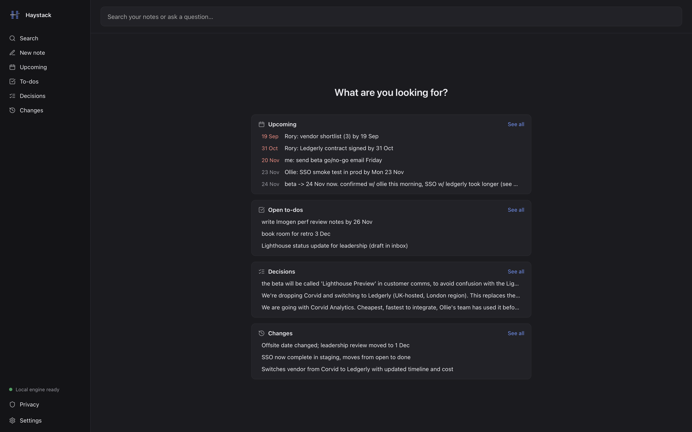
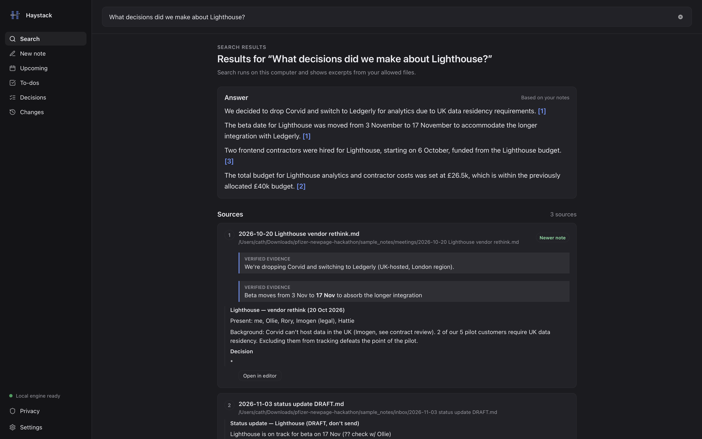
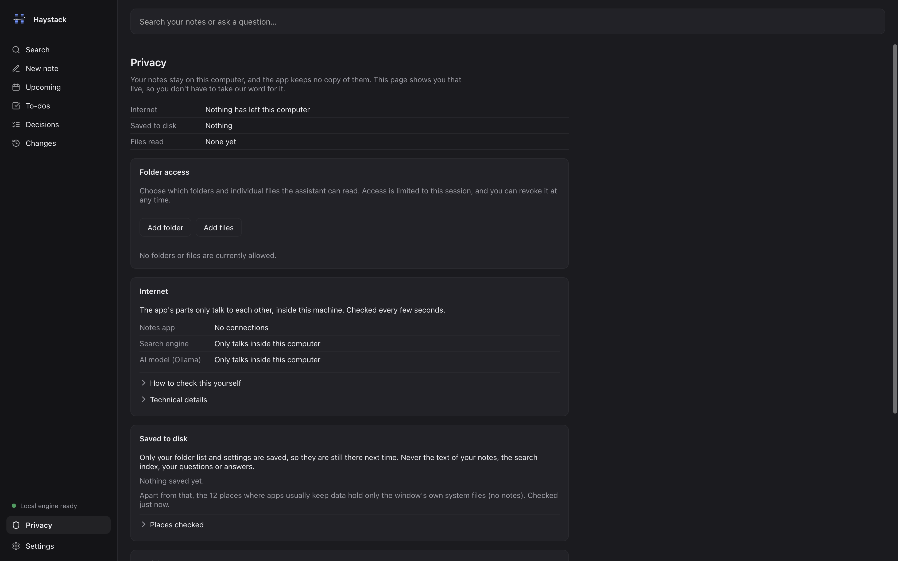

# Haystack


A desktop app that finds the note you mean. Everything runs on your own computer. Nothing leaves it, and the app keeps no copy of your notes.

## Contents

- [The problem](#the-problem)
- [What it does](#what-it-does)
- [Your knowledge stays yours](#your-knowledge-stays-yours)
- [Demo](#demo)
- [Installation](#installation)
- [Development](#development)
- [Team](#team)

## The problem

A manager knows they decided something weeks ago, but not where they wrote it or in what words. The decision sits in one note and the reason it later changed sits in another. And the notes are too personal to hand to a cloud AI.

## What it does

Ask *"What did we decide about the analytics vendor, and has it changed?"* and Haystack:

- **Finds it by meaning**, not just exact words ("budget cut" finds "funding reduced").
- **Answers with sources.** Every claim cites the file and passage it came from, and each quote is checked against the file. If nothing backs an answer, it says so.
- **Flags what changed.** A newer note that replaces or contradicts an older one is shown alongside it.
- **Pulls out the useful bits**: decisions, open to-dos and upcoming dates found in your notes.
- **Reads messy notes**: Markdown, text, Word and PDF, including half-written drafts and duplicates.

## Your knowledge stays yours

- **On device.** The app has no network permission. The engine and the AI model (Ollama) only listen on this computer.
- **No copies.** The search index lives in memory and is gone when the app quits. Passages are re-read from your files when shown. The only file the app saves is a short settings file listing which folders it may read.
- **You can check.** The Privacy page shows network activity, everything the app has stored on disk, and a log of every file it read.
- **You're in control.** Choose which folders it sees, remove one at any time, or press "Forget everything".
- **Instructions in notes are ignored.** Only you give instructions; text inside files is treated as data.

## Demo

**Home:** upcoming dates, open to-dos, decisions and changes, all pulled from your notes.



**Asking a question:** the answer cites its sources, each quote is checked against the file, and a newer note is flagged.



**Privacy:** proof that nothing left the computer or was saved, plus folder access and "Forget everything".



Try it with the fictional notes in `sample_notes/`. [docs/SAMPLE_NOTES.md](docs/SAMPLE_NOTES.md) lists questions to ask and the answers to expect.

## Installation

To use it like a normal app (no terminal), follow **[docs/INSTALL.md](docs/INSTALL.md)**. It has separate steps for Mac, Windows and Linux.

Short version, from the project folder:

```sh
sh scripts/build-app.sh   # builds the app, then installs it
```

Windows: run this in Git Bash.

## Development

### Tech stack

| Part | Used for | Why we chose it |
|---|---|---|
| Tauri v2 + React | Desktop window and UI | Small app with a strict security policy and no network permissions, so the window can't reach the internet |
| Python + FastAPI | Backend | Bound to `127.0.0.1` with a session token, so only the app can talk to it |
| Ollama (`qwen3:4b-instruct`, `nomic-embed-text`) | AI answers and search by meaning | Runs the models on the computer itself. No cloud AI, so notes never leave the device |
| SQLite in memory (FTS5 + sqlite-vec) | Keyword + meaning search index | Lives in memory only and is gone when the app quits, so the app keeps no copy of your notes |
| markitdown + pypdf | Reading PDF, Word, text and Markdown | Parse files locally, with no conversion service |

More detail: [docs/BRIEF.md](docs/BRIEF.md).

### Prerequisites

Install these once:

1. **Node.js 20 or newer** — https://nodejs.org
2. **Python 3.10 or newer** — https://www.python.org/downloads
3. **Rust** (builds the desktop window). Windows: see [docs/INSTALL.md](docs/INSTALL.md). Mac/Linux: run in a terminal:
   ```sh
   curl https://sh.rustup.rs -sSf | sh
   ```
   then close and reopen the terminal.
4. **Ollama** (the local AI model) — https://ollama.com/download (Intel Mac with Homebrew: `brew install --cask ollama-app`). Then download the two models (about 2.3 GB):
   ```sh
   ollama pull qwen3:4b-instruct   # answers and topic names
   ollama pull nomic-embed-text   # search by meaning, grouping
   ```

### Running locally

```sh
npm install                   # first time only
sh scripts/build-sidecar.sh   # builds the Python engine (repeat after backend changes)
npm run tauri dev             # opens the desktop window
```

The first run compiles Rust and can take a few minutes; after that it is fast. The Python engine sets itself up on first run (it creates `backend/.venv`).

**Sample notes:** some files in `sample_notes/` are generated. Run this once after cloning (see [docs/SAMPLE_NOTES.md](docs/SAMPLE_NOTES.md)):

```sh
python3 -m venv /tmp/gen && /tmp/gen/bin/pip install pymupdf python-docx
/tmp/gen/bin/python scripts/make_sample_notes.py
```

### Tests

```sh
cd backend && .venv/bin/pytest && cd ..   # backend tests
npm run build                              # frontend compiles
sh scripts/privacy-guard.sh                # no outside URLs in the code
```

CI runs the same three checks on every push.

### Project structure

| Folder | What |
|---|---|
| `src/` | The UI (React) |
| `src-tauri/` | The desktop window (Rust). Starts the backend, no network access |
| `backend/` | The engine (Python). Reads notes, searches, talks to Ollama. Localhost only |
| `scripts/` | Helper scripts for running and packaging |
| `docs/` | Docs, see below |

### Documentation

- [docs/BRIEF.md](docs/BRIEF.md) — the brief, the One Rule, the safety rules
- [docs/FILES.md](docs/FILES.md) — every file and what it does
- [docs/SAMPLE_NOTES.md](docs/SAMPLE_NOTES.md) — the sample notes, demo questions and edge cases
- [docs/INSTALL.md](docs/INSTALL.md) — install the app on Mac, Windows or Linux
- [docs/DB_DESIGN.md](docs/DB_DESIGN.md) — in-memory database tables and diagram

## Team

| Name | GitHub |
|---|---|
| Cathy | [@cathyc-c](https://github.com/cathyc-c) |
| Eoin | [@ARandomGuyTH](https://github.com/ARandomGuyTH) |
| Lynn | [@lynngoh7](https://github.com/lynngoh7) |
| Shek | [@Reverie-974](https://github.com/Reverie-974) |
