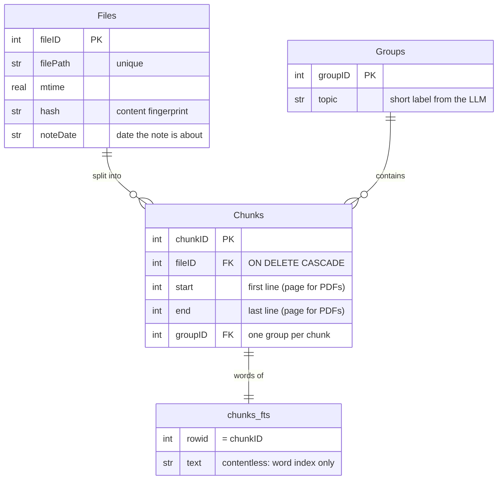

# Database design

In-memory SQLite (`:memory:`), built on launch, gone on quit, "Forget everything" or folder revoke.
No readable note text is stored: chunks are positions in the original file, re-read when shown.
Code: `backend/app/db.py`.

Folder paths and settings are **not** in this database. They live in `prefs.json` (`backend/app/prefs.py`).

## Diagram

## Tables

**Files**: one row per file read from an allowed folder.
| Column | Type | Notes |
|---|---|---|
| fileID | int, PK | |
| filePath | str, unique | real path (after symlinks) |
| mtime | real | last modified time |
| hash | str | SHA-256 of the file. If it differs when a passage is shown, the file changed since indexing and its line numbers are stale, so we don't show it |
| noteDate | str (ISO date) | date in the file name (`2026-09-22 …`), else mtime. Copying files resets mtime, so the name wins. Used for "newer note says otherwise" |

**Chunks**: one row per piece of a file.
| Column | Type | Notes |
|---|---|---|
| chunkID | int, PK | also the `rowid` in `chunks_fts` and the key for vectors |
| fileID | int, FK → Files | `ON DELETE CASCADE`: removing a file removes its chunks |
| start | int | first line, counted from 0 (PDF: page; DOCX: line of the converted Markdown) |
| end | int | last line, inclusive (PDF: page) |
| groupID | int, FK → Groups | one group per chunk |

**Groups**: related chunks, grouped by meaning (`group.py`).
| Column | Type | Notes |
|---|---|---|
| groupID | int, PK | |
| topic | str | e.g. "Q3 budget" |

**chunks_fts**: keyword search (FTS5, `content=''`).
Works like the index at the back of a book: which words appear in which chunk. Contentless means the text itself is not kept, so it can't be read back out.

**Vectors** (search by meaning): one number list per chunk from `nomic-embed-text`, computed once by `group.py` and reused for search.
Kept in a Python dict in `db.py` for now: sqlite-vec needs `enable_load_extension`, which our Python build lacks (brief §9). A plain dot product over ~1000 chunks is fast enough.

## Rules
- No table holds readable note text. Only positions, word indexes and number vectors, all in memory only, gone when the app closes. Passages are re-read from `filePath` lines `start`–`end` (or that PDF page).
- `PRAGMA foreign_keys = ON` is set on connect. SQLite ignores foreign keys without it.
- Revoke (`permissions.on_revoke`) drops the folder's files, chunks, vectors and empty groups at once. Forget everything (`session.on_forget`) replaces the whole database.
- SQLite 3.35 can't delete single rows from a contentless FTS table, so after a removal `chunks_fts` is rebuilt from the remaining chunks, re-read from their files.
- Search input is split into words and each word is quoted, so user input is never read as FTS syntax.
- `topic` is LLM output, so it is memory-only like everything else here.
