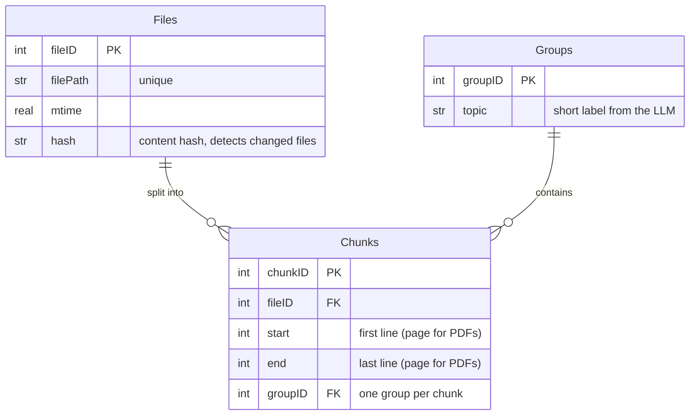

# Database design

In-memory SQLite (`:memory:`), built on launch, gone on quit, "Forget everything" or folder revoke.
No note text is stored: chunks are positions in the original file, re-read when shown.

Folder paths and settings are **not** in this database. They live in `prefs.json` (`backend/app/prefs.py`).

## Diagram

## Tables

**Files** — one row per file read from an allowed folder.
| Column | Type | Notes |
|---|---|---|
| fileID | int, PK | |
| filePath | str, unique | real path (after symlinks) |
| mtime | real | last modified time; newer note wins in conflicts |
| hash | str | content hash; re-chunk only when it changes |

**Chunks** — one row per piece of a file.
| Column | Type | Notes |
|---|---|---|
| chunkID | int, PK | |
| fileID | int, FK → Files | revoke a folder = delete its files' chunks |
| start | int | first line of the chunk, counted from 0 (PDF: page number; DOCX: line of the converted Markdown) |
| end | int | last line of the chunk (PDF: page number) |
| groupID | int, FK → Groups | one group per chunk (demo) |

**Groups** — related chunks, grouped by meaning by the LLM.
| Column | Type | Notes |
|---|---|---|
| groupID | int, PK | |
| topic | str | e.g. "Q3 budget" |

## Rules
- Never add a column holding note text. Show passages by re-reading lines `start`–`end` (or that PDF page) from `filePath`.
- `topic` is LLM output, so it is memory-only like everything else here.
